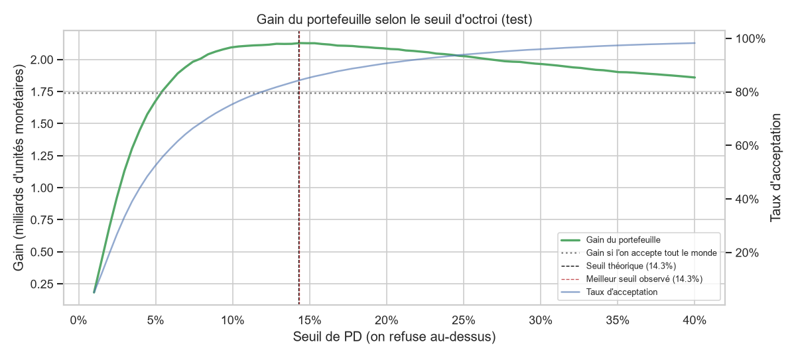

# Scoring de risque de crédit — Home Credit

[](https://github.com/MKkevin2712/credit-risk-scoring/actions/workflows/tests.yml) [](https://credit-risk-scoring-v3skumb2upo62popkvb4xs.streamlit.app/)

> Projet réalisé en octobre 2026 : données, modélisation, décision métier et mise en production.

🚀 **Démo en ligne** : [credit-risk-scoring.streamlit.app](https://credit-risk-scoring-v3skumb2upo62popkvb4xs.streamlit.app/) · 📓 **Notebook Kaggle (en anglais)** : [Credit Risk Scoring: SQL, LightGBM, SHAP](https://www.kaggle.com/code/kevinnkameni/credit-risk-scoring-sql-lightgbm-shap)

## Objectif

Prédire la **probabilité de défaut de paiement** d'un demandeur de crédit, et transformer cette
probabilité en **décision d'octroi** compréhensible par un métier bancaire.

Le projet compare deux approches :

1. **Scorecard** (découpage WoE / IV + régression logistique) : l'approche classique des banques,
   lisible et auditable.
2. **LightGBM** : un modèle de gradient boosting plus performant, rendu interprétable avec **SHAP**.

Il est ensuite industrialisé : code testé, API FastAPI, conteneur Docker, démo Streamlit et
intégration continue.

## Données

[Home Credit Default Risk](https://www.kaggle.com/competitions/home-credit-default-risk) (Kaggle) :
environ 307 000 demandes de crédit et plusieurs tables d'historique (crédits passés auprès
d'autres organismes, demandes précédentes, remboursements).

| Table | Contenu |
|---|---|
| `application_train` | Une ligne par demande, avec la cible `TARGET` (1 = défaut) |
| `bureau`, `bureau_balance` | Crédits du client auprès d'autres organismes |
| `previous_application` | Demandes précédentes chez Home Credit |
| `installments_payments` | Historique des remboursements |
| `credit_card_balance`, `POS_CASH_balance` | Soldes mensuels des cartes et crédits à la consommation |

Les données ne sont pas publiées dans ce dépôt (règlement Kaggle).

## Résultats

| Modèle | Variables | AUC (test) | Gini (test) | KS (test) |
|---|---:|---:|---:|---:|
| Scorecard WoE + régression logistique | 19 | 0,757 | 0,515 | 0,390 |
| LightGBM, réglages initiaux | 170 | 0,788 | 0,576 | 0,437 |
| LightGBM optimisé (Optuna, 30 essais) | 170 | **0,790** | **0,580** | **0,441** |

Les probabilités de défaut sont **bien calibrées** : PD moyenne prédite 8,00 % pour 8,07 % de défauts observés ([notebook](notebooks/05_optimisation_calibration.ipynb)).

Avec la scorecard, les 10 % de clients jugés les plus risqués font **27 % de défauts**, contre **1,1 %** pour les 10 % les moins risqués.
LightGBM gagne près de 6 points de Gini ; ses décisions sont expliquées client par client avec **SHAP** ([notebook](notebooks/04_lgbm_shap.ipynb)).

### Décision d'octroi

Avec une marge de 10 % et une perte de 60 % en cas de défaut (hypothèses illustratives), un crédit est rentable tant que
**PD < 14,3 %**. Sur le test, cette règle accepte **84 %** des demandes, écarte **50 %** des mauvais payeurs
(pour 13 % des bons) et **augmente le gain du portefeuille de 22 %** par rapport à « tout accepter ».

Le risque est aussi exprimé en **score** (600 points = cote de 50 bons pour 1 mauvais, +20 points = cote doublée),
en **classes A à E**, et via une **grille de points** explicable ligne par ligne ([notebook](notebooks/06_decision.ipynb)).



## Utiliser le modèle

### API (FastAPI)

```bash
uv run uvicorn credit_risk_scoring.api:app --reload    # documentation interactive : http://127.0.0.1:8000/docs
```

| Route | Rôle |
|---|---|
| `POST /predict` | PD, score, classe A à E, décision et principales raisons (SHAP) d'une demande |
| `GET /features` | variables attendues, avec leur type et les catégories connues |
| `GET /policy` | règle d'octroi et classes de risque |
| `GET /health` | état du service |

```bash
curl -X POST http://127.0.0.1:8000/predict -H "Content-Type: application/json" -d '{"features": {"EXT_SOURCE_2": 0.62, "EXT_SOURCE_3": 0.51, "AMT_INCOME_TOTAL": 180000, "AMT_CREDIT": 500000, "AMT_ANNUITY": 25000, "DAYS_BIRTH": -14000, "DAYS_EMPLOYED": -2500}}'
```

Les variables dérivées (ratios, âge…) sont **recalculées par l'API exactement comme en SQL** ; un test vérifie
que les deux calculs restent identiques, pour éviter tout écart entre l'entraînement et la production.

### Démo (Streamlit)

```bash
uv run streamlit run app/demo.py
```

On choisit une demande du jeu de test (dont on connaît l'issue réelle) ou un profil type, on modifie ses
caractéristiques (scores externes, revenu, montant, âge…) et on voit en direct la PD, le score, la classe,
la décision et ses raisons.

La version en ligne ne propose que les **profils types** : les données Kaggle ne peuvent pas être publiées
(règlement de la compétition). Seul le modèle final (`models/lgbm.joblib`, 3,5 Mo) est versionné.

### Docker

```bash
docker build -t credit-scoring-api .          # nécessite models/lgbm.joblib (entraîné au préalable)
docker run -p 8000:8000 credit-scoring-api
```

### Intégration continue

À chaque `git push`, GitHub Actions vérifie le style (ruff) et lance les tests sur des données fictives
([workflow](.github/workflows/tests.yml)).

## Plan

- [x] Mise en place du projet
- [x] Analyse exploratoire ([notebook](notebooks/01_exploration.ipynb))
- [x] Features SQL (DuckDB) à partir des tables d'historique : 51 variables ([requêtes](src/credit_risk_scoring/sql/))
- [x] Scorecard WoE / IV + régression logistique : 19 variables, **Gini 0,52 sur le test** ([notebook](notebooks/03_scorecard.ipynb))
- [x] LightGBM et explicabilité SHAP
- [x] Optimisation des hyperparamètres (Optuna) et calibration des probabilités
- [x] Seuil de décision métier, classes de risque et grille de points
- [x] API FastAPI, démo Streamlit, Docker, CI GitHub Actions

## Lancer le projet

Prérequis : [uv](https://docs.astral.sh/uv/) et un compte Kaggle.

```bash
uv sync                                              # environnement Python 3.12 + dépendances
uv run kaggle auth login                             # connexion Kaggle (une seule fois)
uv run python -m credit_risk_scoring.data download   # télécharge les données Kaggle
uv run python -m credit_risk_scoring.data load       # charge les CSV dans DuckDB
uv run python -m credit_risk_scoring.features        # construit data/processed/features.parquet
uv run python -m credit_risk_scoring.scorecard       # entraîne la scorecard → models/scorecard.joblib
uv run python -m credit_risk_scoring.tune            # optimisation Optuna (≈ 1 h) → reports/lgbm_best_params.json
uv run python -m credit_risk_scoring.lgbm            # entraîne LightGBM (≈ 10 min) → models/lgbm.joblib
uv run pytest                                        # tests
uv run jupyter lab                                   # notebooks
```

## Structure

```
data/raw/          données Kaggle (non versionnées)
data/processed/    base DuckDB, features (non versionnées)
notebooks/         analyses exploratoires et résultats
src/credit_risk_scoring/
    config.py      chemins et constantes
    data.py        téléchargement et chargement dans DuckDB
    features.py    assemblage des features (une ligne par demande)
    modeling.py    découpage train/test, indicateurs AUC / Gini / KS
    scorecard.py   scorecard WoE / IV + régression logistique
    lgbm.py        LightGBM avec validation croisée et arrêt anticipé
    tune.py        optimisation des hyperparamètres avec Optuna
    decision.py    seuil d'octroi, rentabilité, score en points, grille de la scorecard
    scoring.py     évaluation d'une demande (PD, score, décision, raisons SHAP)
    api.py         API FastAPI
app/demo.py        démo Streamlit
kaggle/            notebook autonome publié sur Kaggle (en anglais)
    sql/           une requête d'agrégation par table d'historique
tests/             tests pytest
reports/figures/   graphiques
```

## Auteur

Kevin Moukam Nkameni — [github.com/MKkevin2712](https://github.com/MKkevin2712)
