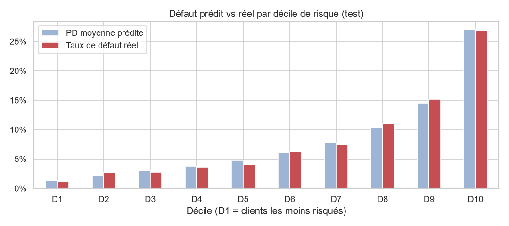

# Scoring de risque de crédit — Home Credit

> 🚧 Projet en cours (octobre–novembre 2026)

## Objectif

Prédire la **probabilité de défaut de paiement** d'un demandeur de crédit, et transformer cette
probabilité en **décision d'octroi** compréhensible par un métier bancaire.

Le projet compare deux approches :

1. **Scorecard** (découpage WoE / IV + régression logistique) : l'approche classique des banques,
   lisible et auditable.
2. **LightGBM** : un modèle de gradient boosting plus performant, rendu interprétable avec **SHAP**.

Il est ensuite industrialisé : code testé, API FastAPI, conteneur Docker, démo Streamlit et
intégration continue.

## Données

[Home Credit Default Risk](https://www.kaggle.com/competitions/home-credit-default-risk) (Kaggle) :
environ 307 000 demandes de crédit et plusieurs tables d'historique (crédits passés auprès
d'autres organismes, demandes précédentes, remboursements).

| Table | Contenu |
|---|---|
| `application_train` | Une ligne par demande, avec la cible `TARGET` (1 = défaut) |
| `bureau`, `bureau_balance` | Crédits du client auprès d'autres organismes |
| `previous_application` | Demandes précédentes chez Home Credit |
| `installments_payments` | Historique des remboursements |
| `credit_card_balance`, `POS_CASH_balance` | Soldes mensuels des cartes et crédits à la consommation |

Les données ne sont pas publiées dans ce dépôt (règlement Kaggle).

## Résultats

| Modèle | Variables | AUC (test) | Gini (test) | KS (test) |
|---|---:|---:|---:|---:|
| Scorecard WoE + régression logistique | 18 | 0,759 | 0,517 | 0,392 |
| LightGBM (755 arbres, validation croisée 5 plis) | 170 | **0,788** | **0,575** | **0,436** |

Avec la scorecard, les 10 % de clients jugés les plus risqués font **27 % de défauts**, contre **1,3 %** pour les 10 % les moins risqués.
LightGBM gagne près de 6 points de Gini ; ses décisions sont expliquées client par client avec **SHAP** ([notebook](notebooks/04_lgbm_shap.ipynb)).



## Plan

- [x] Mise en place du projet
- [x] Analyse exploratoire ([notebook](notebooks/01_exploration.ipynb))
- [x] Features SQL (DuckDB) à partir des tables d'historique : 51 variables ([requêtes](src/credit_risk_scoring/sql/))
- [x] Scorecard WoE / IV + régression logistique : 18 variables, **Gini 0,52 sur le test** ([notebook](notebooks/03_scorecard.ipynb))
- [x] LightGBM et explicabilité SHAP
- [ ] Optimisation des hyperparamètres (Optuna) et calibration des probabilités
- [ ] Seuil de décision métier et grille de score
- [ ] API FastAPI, Docker, démo Streamlit, CI GitHub Actions

## Lancer le projet

Prérequis : [uv](https://docs.astral.sh/uv/) et un compte Kaggle.

```bash
uv sync                                              # environnement Python 3.12 + dépendances
uv run kaggle auth login                             # connexion Kaggle (une seule fois)
uv run python -m credit_risk_scoring.data download   # télécharge les données Kaggle
uv run python -m credit_risk_scoring.data load       # charge les CSV dans DuckDB
uv run python -m credit_risk_scoring.features        # construit data/processed/features.parquet
uv run python -m credit_risk_scoring.scorecard       # entraîne la scorecard → models/scorecard.joblib
uv run python -m credit_risk_scoring.lgbm            # entraîne LightGBM (≈ 6 min) → models/lgbm.joblib
uv run pytest                                        # tests
uv run jupyter lab                                   # notebooks
```

## Structure

```
data/raw/          données Kaggle (non versionnées)
data/processed/    base DuckDB, features (non versionnées)
notebooks/         analyses exploratoires et résultats
src/credit_risk_scoring/
    config.py      chemins et constantes
    data.py        téléchargement et chargement dans DuckDB
    features.py    assemblage des features (une ligne par demande)
    modeling.py    découpage train/test, indicateurs AUC / Gini / KS
    scorecard.py   scorecard WoE / IV + régression logistique
    lgbm.py        LightGBM avec validation croisée et arrêt anticipé
    sql/           une requête d'agrégation par table d'historique
tests/             tests pytest
reports/figures/   graphiques
```

## Auteur

Kevin Moukam Nkameni — [github.com/MKkevin2712](https://github.com/MKkevin2712)
